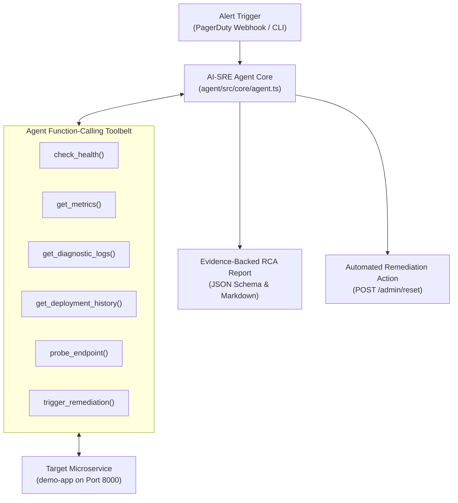

# 🤖 AI-SRE Autonomous Incident Diagnosis Agent

> **An autonomous Site Reliability Engineering AI Agent built in TypeScript that investigates microservice failures, correlates multi-modal telemetry (metrics, logs, health probes, deployment histories), and produces evidence-backed Root Cause Analysis (RCA) reports with automated remediation.**

---

## 🌟 Resume Highlights & Key Capabilities

- **Autonomous ReAct Investigation Loop**: Employs reasoning + action function-calling cycles to explore service degradation without human intervention.
- **Multi-Source Telemetry Correlation**: Correlates Google SRE "Golden Signals" (error rate, p95 latency, cgroup memory limits) with circular log buffer stack traces and git deployment audit trails.
- **Evidence-Backed Root Cause Analysis (RCA)**: Outputs strict, machine-readable JSON and human-readable Markdown diagnostic reports with confidence scoring.
- **Automated Remediation**: Can trigger targeted remediation actions (e.g. rolling back bad deployments, clearing database connection pool locks, or resetting state).
- **Dual Operating Modes**:
  1. **LLM Function-Calling Mode**: Powered by Google Gemini (`@google/genai`) using native tool declarations and iterative step execution.
  2. **Deterministic Diagnostic Mode**: Telemetry heuristic engine for zero-configuration, instant offline evaluation without API keys.
- **REST API + Webhook + CLI**: Supports command-line execution (`npm run investigate`), automated benchmark testing (`npm run benchmark`), and HTTP alert ingestion (`POST /api/investigate`).

---

## 🛠️ Architecture



---

## 🚀 Quick Start

### 1. Start the Demo Target Microservice

In a separate terminal:

```bash
cd demo-app
npm run dev
```

_(Runs on `http://localhost:8000`)_

### 2. Configure Agent Environment

In the `agent` directory:

```bash
cd agent
cp .env.example .env
```

_(Optional: Add your `GEMINI_API_KEY` in `.env` to enable live LLM function calling. If left blank, the agent runs in high-speed telemetry diagnostic mode)._

### 3. Run Autonomous Investigation via CLI

```bash
npm run investigate
```

To auto-remediate the incident upon diagnosis:

```bash
npm run investigate -- --remediate
```

### 4. Run the 7-Scenario Benchmark Suite

```bash
npm run benchmark
```

Executes all 7 real-world failure modes (Null pointer, DB pool exhaustion, high latency, service unavailable, bad deployment, memory pressure, and rate limiting) and generates a verification scorecard.

---

## 📡 REST API Reference (Port 4242)

Start the agent API server:

```bash
npm run dev
```

### Endpoints

- `POST /api/investigate`: Triggers an on-demand investigation.
  ```json
  {
    "incidentId": "INC-2026-99",
    "alertMessage": "Spike in HTTP 500s detected on /api/orders",
    "autoRemediate": true
  }
  ```
- `POST /api/webhook`: Ingests standard monitoring alerts (Alertmanager / PagerDuty / Datadog format) to queue background triage.
- `POST /api/remediate`: Executes direct remediation action (`RESET_STATE`, `ROLLBACK_DEPLOYMENT`).
- `GET /api/health`: Verifies agent status and LLM connection.

---

## 📋 Sample Generated RCA Output

```json
{
  "incidentId": "INC-8124",
  "severity": "CRITICAL",
  "failingService": "order-service",
  "affectedEndpoints": ["/api/orders"],
  "healthyEndpoints": ["/api/users"],
  "rootCauseCategory": "BAD_DEPLOYMENT",
  "summary": "Release v2.4.2-buggy introduced a fatal TypeError in discount calculation logic.",
  "detailedDiagnosis": "Runtime exception triggered on /api/orders due to TypeError: Cannot read properties of undefined (reading 'calculateDiscount') in discount_calculator.ts:42. Errors perfectly coincide with the deployment of commit f92a3c1.",
  "evidence": {
    "healthProbe": "Status: HEALTHY (200) | Checks: {\"database\":\"UP\",\"cache\":\"UP\",\"disk\":\"UP\"}",
    "metrics": "Error rate: 100%, p95 latency: 18.2ms, Memory: 135.2MB (26.4%)",
    "logs": "[ERROR] TypeError in DiscountEngine: Cannot read properties of undefined (version v2.4.2-buggy)",
    "deployments": "Active: v2.4.2-buggy | Latest: v2.4.2-buggy (feat(billing): rapid discount pricing hotfix)"
  },
  "remediation": {
    "immediateAction": "Immediately rollback deployment from v2.4.2-buggy to previous stable version v2.4.1.",
    "longTermFix": "Add automated canary testing and pre-deployment integration regression tests for the discount engine.",
    "canAutoRemediate": true,
    "recommendedRemediationType": "ROLLBACK_DEPLOYMENT"
  },
  "confidenceScore": 98
}
```
