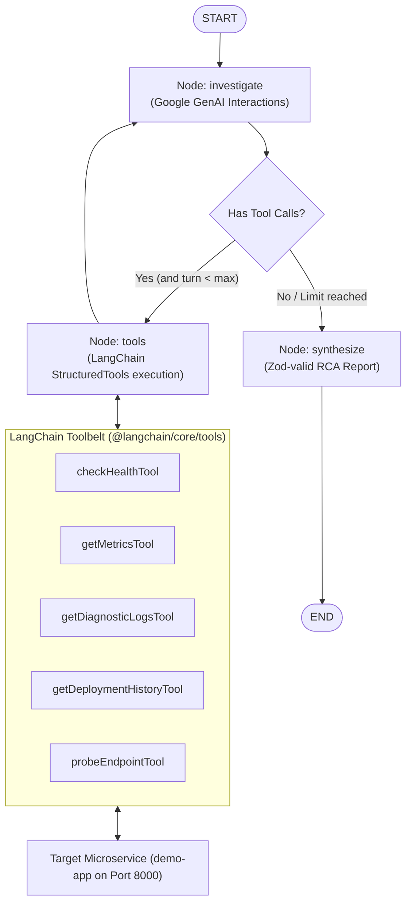

# 🤖 AI-SRE Autonomous Incident Diagnosis Agent (LangGraph & LangChain)

> **An autonomous Site Reliability Engineering AI Agent built in TypeScript using LangGraph StateGraph and LangChain. It investigates microservice outages inside Docker/Kubernetes environments, correlates multi-modal telemetry (metrics, error logs, health probes, git deployment audit trails), and synthesizes evidence-backed Root Cause Analysis (RCA) reports with automated remediation.**

---

## 🌟 Resume Highlights & Frameworks Used

- **LangGraph StateGraph (`@langchain/langgraph`)**: Orchestrates the multi-step diagnostic lifecycle through a stateful graph containing specialized nodes (`investigate`, `tools`, `synthesize`), conditional routing, and cyclic feedback loops.
- **LangChain Structured Tools (`@langchain/core/tools`)**: Implements type-safe, read-only diagnostic tools using Zod parameter validation (`check_health`, `get_metrics`, `get_diagnostic_logs`, `get_deployment_history`, `probe_endpoint`).
- **Google GenAI Interactions (`@google/genai`)**: Connects Gemini tool calling to the graph with server-side interaction continuation (`previous_interaction_id`).
- **Multi-Source Telemetry Correlation**: Correlates Google SRE "Golden Signals" (error rate, p95 latency, cgroup memory limits) with circular log buffer stack traces and git deployment audit trails.
- **Evidence-Backed Root Cause Analysis (RCA)**: Outputs strict, machine-readable JSON and human-readable Markdown diagnostic reports with confidence scoring.
- **Guarded Remediation**: The model has read-only tools. Remediation requires an explicit CLI flag or an authenticated API request; this demo target can automatically reset state only, while other actions remain operator recommendations.
- **Dual Operating Modes**:
  1. **LangGraph LLM Mode**: Powered by LangGraph StateGraph + LangChain Gemini 3.8 Flash.
  2. **Deterministic Diagnostic Mode**: Telemetry heuristic engine for zero-configuration, instant offline evaluation without API keys.
- **REST API + Webhook + CLI**: Supports command-line execution (`npm run investigate`), automated benchmark testing (`npm run benchmark`), and HTTP alert ingestion (`POST /api/investigate`).

---

## 🛠️ LangGraph StateGraph Architecture



### Graph Module Layout

```text
src/core/
  agent.ts                 # Small public facade used by the CLI and HTTP API
  graph/
    state.ts               # Shared LangGraph state annotation and types
    graph.ts               # Wires nodes, edges, and conditional routing
    routing.ts             # Chooses tools or report synthesis after each model turn
    nodes/
      investigate.ts       # Gemini interaction and requested tool calls
      tools.ts             # Safe execution of diagnostic tools
      synthesize.ts        # Validates the RCA or uses the deterministic fallback
  heuristics.ts            # Deterministic telemetry correlation fallback
  report-parser.ts         # Parses and validates model JSON against the RCA schema
```

---

## 🚀 Quick Start

### 1. Start the Demo Target Microservice

In a separate terminal:

```bash
cd demo-app
npm run dev
```

_(Runs on `http://localhost:8000`)_

### 2. Configure Agent Environment

In the `agent` directory:

```bash
cd agent
cp .env.example .env
```

_(Add your `GEMINI_API_KEY` in `.env` to enable live LangGraph execution. If left blank, the agent runs in high-speed telemetry diagnostic mode)._

### 3. Run Autonomous Investigation via CLI (LangGraph)

```bash
npm run investigate
```

To auto-remediate the incident upon diagnosis:

```bash
npm run investigate -- --remediate
```

### 4. Run the 7-Scenario Benchmark Suite

```bash
npm run benchmark
```

Executes all 7 real-world failure modes (Null pointer, DB pool exhaustion, high latency, service unavailable, bad deployment, memory pressure, and rate limiting) and generates a verification scorecard.

---

## 📡 REST API Reference (Port 4242)

Start the agent API server:

```bash
npm run dev
```

### Endpoints

- `POST /api/investigate`: Triggers an on-demand LangGraph investigation. Set `autoRemediate: true` only with the `x-agent-api-key` header and a configured `AGENT_API_KEY`.
  ```json
  {
    "incidentId": "INC-2026-99",
    "alertMessage": "Spike in HTTP 500s detected on /api/orders",
    "autoRemediate": true
  }
  ```
- `POST /api/webhook`: Ingests standard monitoring alerts (Alertmanager / PagerDuty / Datadog format) to queue background triage.
- `POST /api/remediate`: Executes the demo target's only supported automated action, `RESET_STATE`; it requires `x-agent-api-key`.
- `GET /api/health`: Verifies agent status, LangGraph orchestrator, and LLM connection.

---

## 📋 Sample Generated RCA Output

```json
{
  "incidentId": "INC-8124",
  "severity": "CRITICAL",
  "failingService": "order-service",
  "affectedEndpoints": ["/api/orders"],
  "healthyEndpoints": ["/api/users"],
  "rootCauseCategory": "BAD_DEPLOYMENT",
  "summary": "Release v2.4.2-buggy introduced a fatal TypeError in discount calculation logic.",
  "detailedDiagnosis": "Runtime exception triggered on /api/orders due to TypeError: Cannot read properties of undefined (reading 'calculateDiscount') in discount_calculator.ts:42. Errors perfectly coincide with the deployment of commit f92a3c1.",
  "evidence": {
    "healthProbe": "Status: HEALTHY (200) | Checks: {\"database\":\"UP\",\"cache\":\"UP\",\"disk\":\"UP\"}",
    "metrics": "Error rate: 100%, p95 latency: 18.2ms, Memory: 135.2MB (26.4%)",
    "logs": "[ERROR] TypeError in DiscountEngine: Cannot read properties of undefined (version v2.4.2-buggy)",
    "deployments": "Active: v2.4.2-buggy | Latest: v2.4.2-buggy (feat(billing): rapid discount pricing hotfix)"
  },
  "remediation": {
    "immediateAction": "Immediately rollback deployment from v2.4.2-buggy to previous stable version v2.4.1.",
    "longTermFix": "Add automated canary testing and pre-deployment integration regression tests for the discount engine.",
    "canAutoRemediate": true,
    "recommendedRemediationType": "ROLLBACK_DEPLOYMENT"
  },
  "confidenceScore": 98
}
```
